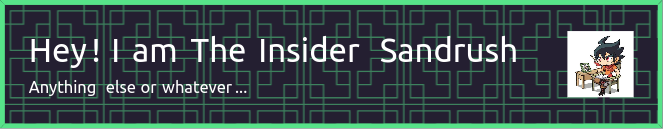

     

### Hi there 👋

- 🔭 I’m currently working on my own Minecraft mod (if), HTML webpage (and more) for fun, and learning.
- 🌱 I’m currently <strike>learning</strike> resuming on learning HTML basics, Java, C# and C++.
> Due to financial reasons, I might not be able to resume everything where I left off.
- 👯 I’m looking to collaborate on someone that has more experience than me.
- 🤔 I’m looking for help.
- 💬 Ask me about: h
- 📫 How to reach me: You can contact me via [Bluesky](https://bsky.app/profile/did:plc:zdtbxbe2lvxc3aiyplqivtyd), and [Mastodon](https://mastodon.social/@theinsidersandrush@pawoo.net). Anywhere else, visit [theinsidersandrush.github.io/socials](https://theinsidersandrush.github.io/socials "This link will redirect you to The Insider Sandrush's website.")
- 😄 Pronouns: He/Him, They/Them
- ⚡ Fact: The profile picture are actually a character named [Alex](https://the-golden-age-of-adventure.fandom.com/wiki/Alex "This wiki page is hosted on Fandom, and you might getting a much ton of ads. Please consider using an ad-blocker to preventing this from happening.") from [The Golden Age of Adventures](https://www.shop.gempakstarz.com/learnmore/x-venture-the-golden-age-of-adventures), a comic series made by a Malaysian book publisher, [Gempak Starz](https://www.gempakstarz.com). It was written by Tadatada (artist), illustrations goes to Solar Team (artist group).

__Want to know more about me? Check out [here](https://web.archive.org/web/20000301045908/http://x.com/). (Due to legal reasons, we need to clarify that this is untrue.)__

__Read the old README [here](OLDREADME.md) if you want it.__

[Artwork by Hamonika Monika (linked to third-party site)](https://danbooru.donmai.us/posts/6682205)

